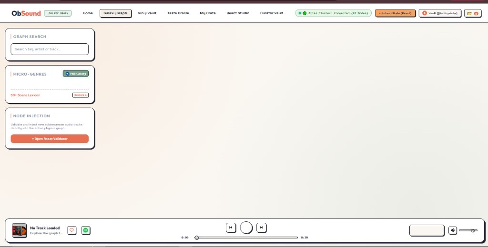
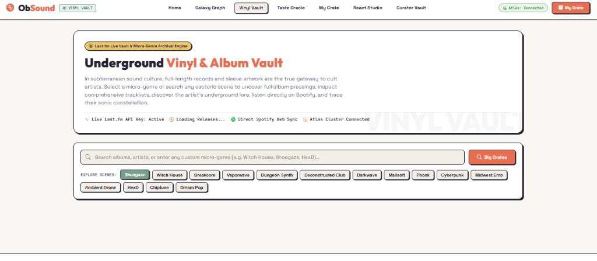
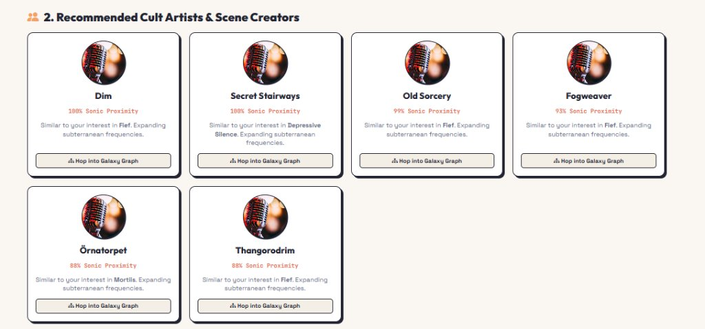
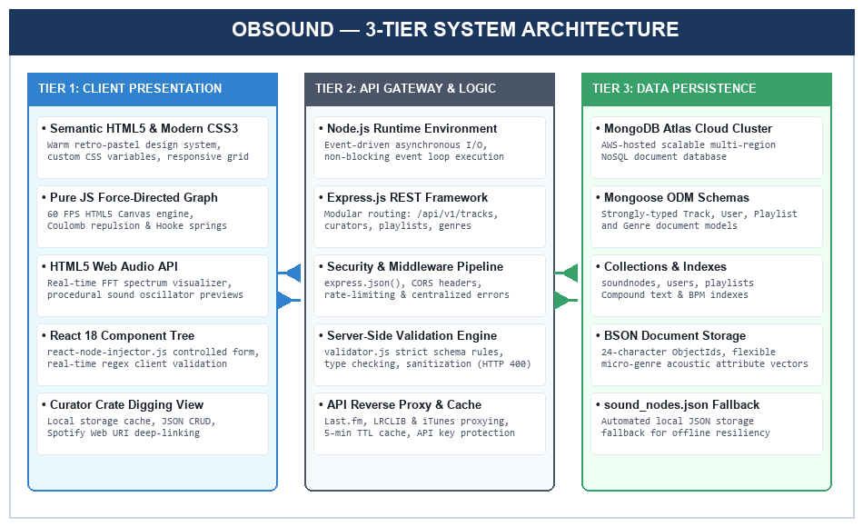
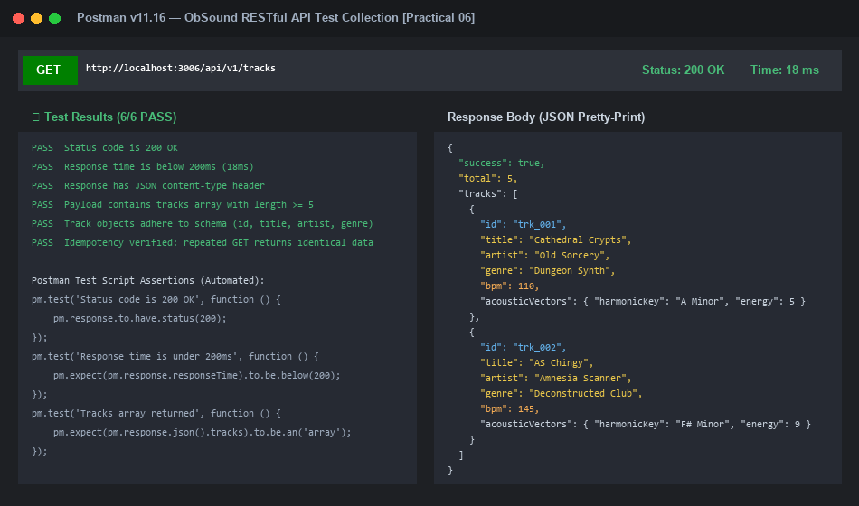
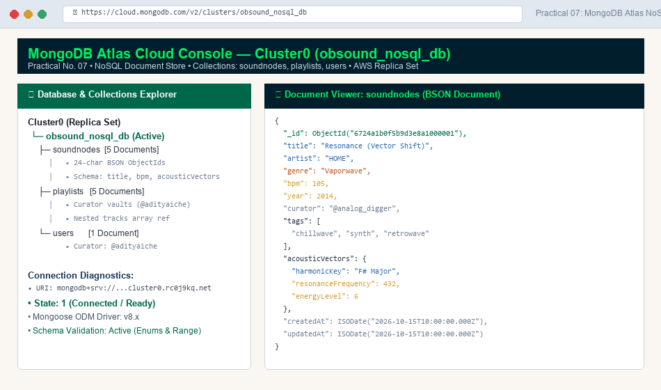

<div align="center">

# 🪐 ObSound — Subterranean Music Discovery Network

**An Autonomous 2D Physics-Based Graph Architecture for Crate Digging & Micro-Genre Sonic Exploration**

[](https://obsound.netlify.app)
[](https://aniche59.github.io/obsound/)
[](https://nodejs.org/)
[](https://react.dev/)
[](https://expressjs.com/)
[](https://www.mongodb.com/atlas)
[](LICENSE)

</div>

---

## 🌐 Live Deployments & Exploration Routes

| Environment / Route | URL / Endpoint | Description |
| :--- | :--- | :--- |
| 🚀 **Primary Cloud Production** | [https://obsound.netlify.app/](https://obsound.netlify.app/) | Live production application mesh deployed on Netlify |
| 🌐 **Secondary Public Mirror** | [https://aniche59.github.io/obsound/](https://aniche59.github.io/obsound/) | Static client mirror hosted on GitHub Pages |
| 🌌 **2D Physics Galaxy Graph** | [https://obsound.netlify.app/app.html](https://obsound.netlify.app/app.html) | Force-directed constellation explorer & audio engine |
| 💿 **Underground Vinyl Vault** | [https://obsound.netlify.app/albums.html](https://obsound.netlify.app/albums.html) | 24 Curated LP pressings & scene filter lexicon |
| 🔮 **Cult Artist Taste Oracle** | [https://obsound.netlify.app/recommendations.html](https://obsound.netlify.app/recommendations.html) | Subterranean sonic proximity & similarity engine |
| 📦 **Crate Digging & Library** | [https://obsound.netlify.app/crate.html](https://obsound.netlify.app/crate.html) | Interactive digital crate, JSON persistence & export |
| ⚛️ **React 18 Node Studio** | [https://obsound.netlify.app/react-studio.html](https://obsound.netlify.app/react-studio.html) | Form validation studio & direct graph node injector |
| ⚡ **Netlify Serverless API Status** | [https://obsound.netlify.app/.netlify/functions/api/nosql/status](https://obsound.netlify.app/.netlify/functions/api/nosql/status) | Real-time cloud cluster health & document statistics |

---

## 📖 Table of Contents
1. [The Problem: Algorithmic Monoculture](#-the-problem-algorithmic-monoculture)
2. [The Solution: ObSound](#-the-solution-obsound)
3. [Visual Walkthrough & Screenshots](#-visual-walkthrough--screenshots)
4. [System Architecture](#-system-architecture)
5. [Core Technical Features](#-core-technical-features)
6. [Dual-Layer Validation Engine](#-dual-layer-validation-engine)
7. [RESTful API Specification](#-restful-api-specification)
8. [Local Development & Setup](#-local-development--setup)
9. [Project Team & Contributors](#-project-team--contributors)

---

## 🚨 The Problem: Algorithmic Monoculture

Mainstream digital music streaming services (Spotify, Apple Music, YouTube Music) rely predominantly on closed collaborative filtering and listener-retention algorithms. These systems are mathematically tuned for commercial retention, corporate payola, and mainstream virality. 

Consequently, they create self-reinforcing **algorithmic echo chambers**: high-visibility tracks with millions of historical plays are repeatedly amplified, while DIY artists, regional music collectives, and obscure underground micro-genres (*HexD, Mallsoft, Dungeon Synth, Deconstructed Club, Chiptune, Darkwave, and Shoegaze*) are buried beneath what data retrieval literature terms the severe **cold-start problem**.

---

## ⚡ The Solution: ObSound

**ObSound** is an autonomous, open-source subterranean music discovery platform that counteracts algorithmic monoculture. It replaces closed commercial metrics with **an interactive 2D physics-based relational graph** rendered at 60 FPS on an HTML5 `<canvas>`. 

In ObSound, music tracks are represented as celestial bodies clustered dynamically through intrinsic acoustic affinity vectors:
* **Tempo (BPM Proximity):** Nodes with compatible tempos gravitate together.
* **Harmonic Musical Key Compatibility:** Mathematical alignment along the Camelot Wheel / Circle of Fifths.
* **Communal Resonance Tags:** Shared aesthetic descriptors bond nodes with elastic topological springs.
* **Human Crate Curation:** Curators discover, catalog, and submit newly unearthed gems directly into the graph.

---

## 📸 Visual Walkthrough & Screenshots

### 1. Celestial 2D Physics Galaxy Graph
Interactive force-directed graph with subterranean micro-genre clusters, celestial physics, and synchronized Web Audio player.


---

### 2. Underground Vinyl & Album Vault
24 hand-picked underground full-length LP releases with scene filter lexicon, vinyl sleeve flip animations, and direct playback.


---

### 3. Cult Artist Taste Oracle & Subterranean Sonic Proximity
Acoustic proximity recommendation engine that surfaces obscure creators based on cult artist archetypes and micro-genre affinities.


---

### 4. Decoupled 3-Tier Full-Stack Architecture
Clear separation between Presentation Sandbox (Tier 1), Node.js/Express API Gateway Reverse-Proxy (Tier 2), and MongoDB Atlas Cloud Persistence (Tier 3).


---

### 5. Automated RESTful API Testing & Cloud Database Persistence
Automated Postman test suite validating HTTP status codes (200, 201, 400, 404) and live MongoDB Atlas cluster document persistence.
<div align="center">
  
  
</div>

---

## 🏗️ System Architecture

ObSound is engineered following the **12-Factor App methodology** and structured as a decoupled 3-tier system:

```
┌──────────────────────────────────────────────────────────────────────────────────┐
│                             TIER 1: PRESENTATION LAYER                            │
│  • Semantic HTML5 & Modern Vanilla CSS3 (Retro-Pastel Indie Zine Design Tokens)  │
│  • Pure JavaScript ES6+ Force-Directed 2D Physics Canvas Engine (60 FPS)         │
│  • HTML5 Web Audio API (Synthesizer Oscillators & 1024-Point FFT Spectrum Visual)│
│  • React 18 Component Tree with Controlled State & Real-Time Client Validation   │
└────────────────────────────────────────┬─────────────────────────────────────────┘
                                         │ Standard RESTful HTTP/JSON (CORS Shielded)
                                         ▼
┌──────────────────────────────────────────────────────────────────────────────────┐
│                    TIER 2: APPLICATION & API GATEWAY LAYER                       │
│  • Asynchronous Node.js Runtime & Express.js REST Framework                      │
│  • Netlify Serverless Cloud Functions (AWS Lambda Architecture)                  │
│  • Intelligent API Gateway Reverse-Proxy (Shields Last.fm, LRCLIB & iTunes Keys) │
│  • Server-Side Validation Middleware (Regex & Type Verification with HTTP 400)   │
│  • In-Memory Response Caching Layer (5-Minute TTL)                               │
└────────────────────────────────────────┬─────────────────────────────────────────┘
                                         │ Secure Mongoose ODM Driver (TLS Encrypted)
                                         ▼
┌──────────────────────────────────────────────────────────────────────────────────┐
│                         TIER 3: DATA PERSISTENCE LAYER                           │
│  • MongoDB Atlas Cloud NoSQL Cluster (M0 Sandbox - cluster0.rc0j9kq.mongodb.net)│
│  • Strongly Typed Collections: soundnodes (160+ tracks), playlists, and users    │
│  • Automated Resilient LocalStorage & JSON File Fallbacks for Offline Continuity │
└──────────────────────────────────────────────────────────────────────────────────┘
```

---

## 🌟 Core Technical Features

### 🌌 1. Custom 2D Force-Directed Physics Simulation
* **Coulomb Repulsion:** Every node pair repels with force inversely proportional to distance squared ($\mathbf{F}_r \propto 1/d^2$), avoiding clutter.
* **Hooke's Elastic Attraction:** Nodes sharing harmonic keys or micro-genre tags attract like physical springs ($\mathbf{F}_s = k(d - l_0)$).
* **Kinetic Velocity Damping:** Friction coefficient ($\gamma = 0.92$) smoothly settles the galaxy into organic equilibrium.

### 🎛️ 2. Digital Signal Processing (Web Audio API)
* Custom in-browser synthesizer generates procedural harmonic audio frequency previews without external dependencies.
* Connects an `AnalyserNode` to the master audio gain bus, computing a real-time **1024-point Fast Fourier Transform (FFT)** rendered as an animated multi-frequency spectrum bar visualizer.

### 💿 3. Underground Vinyl Vault & Crate Digging
* Browse 24 full-length vinyl LP pressings across 15+ subterranean micro-genres.
* Scene filters: HexD, Dungeon Synth, Mallsoft, Barber Beats, Deconstructed Club, Chiptune, Darkwave, Shoegaze, and Witch House.
* Interactive crate management table with real-time text searching, folder sorting, and one-click JSON crate backup exports.
* One-click conversion to formatted search queries for instant discovery on Spotify.

### 🔮 4. Cult Artist Taste Oracle
* Input your favorite cult or obscure artist to calculate acoustic similarity vectors.
* Recommends underground sound creators with percentage-based sonic proximity metrics.

---

## 🛡️ Dual-Layer Validation Engine

To ensure persistent data integrity, ObSound implements an airtight dual-layer validation model:

| Attribute | Client-Side Validation (Tier 1) | Server-Side Validation (Tier 2) |
| :--- | :--- | :--- |
| **Component / File** | `public/react-node-injector.js` (React 18) | `server.js` & `validator.js` (Node/Express) |
| **Trigger Event** | Real-time `onChange` & modal form submit | Incoming HTTP `POST` / `PUT` payload stream |
| **Primary Goal** | Instantaneous user feedback & visual guidance | Zero malformed data ingestion & injection defense |
| **Bypass Resistance** | Client-level (can be bypassed via DevTools/cURL) | Absolute (cannot be bypassed; enforces HTTP 400) |
| **Failure Feedback** | Red input border & inline text warning alert | Structured JSON list of errors with HTTP 400 code |
| **Sanitization** | Strips dangerous script tags from UI | Escapes input strings and strips malicious XSS tags |

---

## 📡 RESTful API Specification

The Node.js/Express API Gateway exposes standardized RESTful endpoints:

| HTTP Verb | Endpoint Route | Idempotent | Expected Status | Description |
| :--- | :--- | :--- | :--- | :--- |
| `GET` | `/api/v1/tracks` | Yes | `200 OK` | Retrieves all subterranean sound nodes |
| `GET` | `/api/v1/tracks/:id` | Yes | `200 OK` / `404` | Retrieves a single sound node by ObjectId |
| `POST` | `/api/v1/tracks` | No | `201 Created` | Ingests and validates a new sound node |
| `PUT` | `/api/v1/tracks/:id` | Yes | `200 OK` | Replaces a sound node document |
| `PATCH` | `/api/v1/tracks/:id` | Yes | `200 OK` | Partially updates a sound node (BPM/tags) |
| `DELETE` | `/api/v1/tracks/:id` | Yes | `200 OK` / `204` | Removes track from persistent store |
| `GET` | `/api/recommendations` | Yes | `200 OK` | Returns similarity clusters for cult artists |
| `GET` | `/api/albums` | Yes | `200 OK` | Retrieves 24 curated underground LP vault pressings |
| `GET` | `/api/nosql/status` | Yes | `200 OK` | Returns live MongoDB Atlas cluster document metrics |

### Sample Request Payload (`POST /api/v1/tracks`):
```json
{
  "title": "Subterranean Echoes",
  "artist": "VaporGhost",
  "genre": "HexD",
  "bpm": 142,
  "key": "8A",
  "curatorHandle": "@adityaiche",
  "audioUrl": "https://cdn.obsound.org/streams/vaporghost_echoes.mp3",
  "tags": ["lo-fi", "bitcrush", "reverb", "underground"]
}
```

### Sample Response (`HTTP 201 Created`):
```json
{
  "success": true,
  "message": "Sound node successfully ingested into ObSound graph.",
  "data": {
    "_id": "673752e89f182c0012a9d8f1",
    "title": "Subterranean Echoes",
    "artist": "VaporGhost",
    "genre": "HexD",
    "bpm": 142,
    "curatorHandle": "@adityaiche",
    "createdAt": "2026-11-23T12:30:00.000Z"
  }
}
```

---

## 💻 Local Development & Setup

### Prerequisites
* **Node.js:** v18.16.0 LTS or higher
* **npm:** v9.x or higher
* Modern web browser (Chrome, Firefox, Safari, Edge)

### 1. Clone the Repository
```bash
git clone https://github.com/aniche59/obsound.git
cd obsound
```

### 2. Install Dependencies
```bash
npm install
```

### 3. Configure Environment Variables
Copy `.env.example` to `.env`:
```bash
cp .env.example .env
```
Populate `.env` with your API credentials (optional for offline mode):
```env
PORT=3001
MONGODB_URI=mongodb+srv://<username>:<password>@cluster0.rc0j9kq.mongodb.net/obsound_nosql_db?retryWrites=true&w=majority
LASTFM_API_KEY=your_lastfm_api_key
```

### 4. Run the Application
```bash
# Production server mode
npm start

# Development live-reload mode
npm run dev
```

Open your browser to:
```
http://localhost:3001
```

---

## 👥 Project Team & Contributors

* **Aditya Iche** — *Lead Full-Stack Architecture, Graph Physics Engine & Web Audio DSP* — [GitHub (@aniche59)](https://github.com/aniche59) (PRN: 202401100136)
* **Mohsin Khan** — *React 18 Node Studio & Dual-Layer Validation Engine* (PRN: 202401100126)
* **Anvith Shetty** — *RESTful API Gateway, Postman Testing & MongoDB Cloud Persistence* (PRN: 202401100138)

**Academic Advisor & Course Guide:** **Mr. Suhas Kothavle**, Department of Software Engineering, MIT Academy of Engineering, Alandi (D), Pune.

---

## 📄 License
This project is open-source and released under the terms of the [MIT License](LICENSE).
